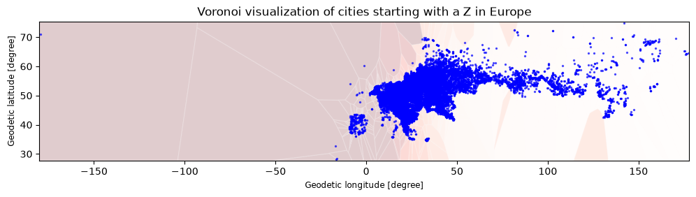
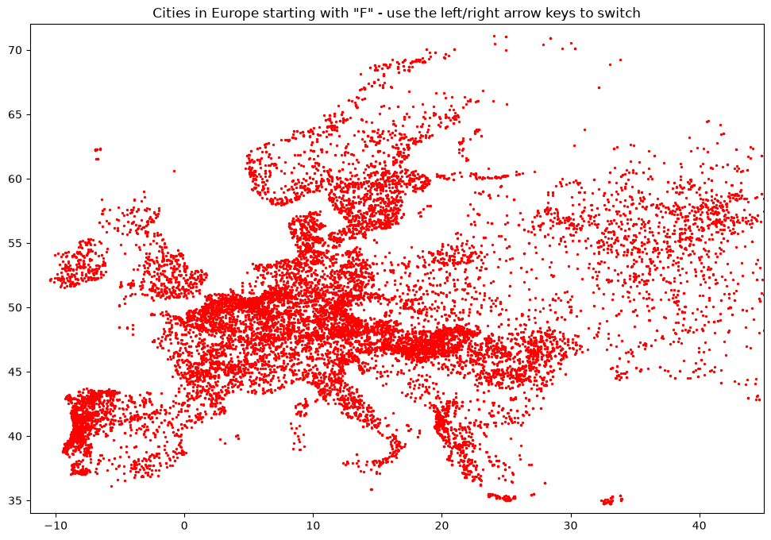

# Analysis of European Cities Starting with the Letter "Z"

## 1. Problem / Research Question

This project explores a global cities population dataset to answer a focused research question:

**How are European cities whose names start with the letter "Z" distributed across the continent, and can we visualize their spatial pattern using geospatial analysis?**

The analysis also compares the size of the European subset against the global dataset and demonstrates interactive and Voronoi-based mapping techniques for urban geography.

## 2. Dataset Source and Usage Permissions

- **Dataset name:** `world_cities_pop.csv` (world cities population dataset)
- **Source:** Provided by CISC7204 course materials.
- **License / Permission:** Used for educational purposes as part of CISC7204 coursework. No personally identifiable information (PII) is included.
- **Note:** The dataset is approximately 156 MB and is **not included** in this repository because it exceeds GitHub's 100 MB file size limit.
- **Data quality note:** Population values for some small cities are recorded as `NaN` (missing), which is preserved as-is in the analysis.

## 3. Methods and Tools

### Tools

- **Language:** Python 3.x
- **Environment:** Jupyter Notebook / VS Code
- **Libraries:**
  - `pandas` — data loading, filtering, transformation
  - `geopandas` — geospatial data handling
  - `matplotlib` — static and interactive plotting
  - `shapely` — geometric operations (points, boxes, Voronoi diagrams)
  - `IPython.display` — inline animation of frames in Jupyter

### Methods

1. **Data loading and inspection** — read the CSV with `pandas`, rename `Latitude`/`Longitude` to `lat`/`lon`.
2. **Filtering by continent** — use a manually defined list of European country codes to extract the European subset.
3. **Filtering by city name** — extract European cities whose names start with "Z".
4. **Geospatial construction** — build a `GeoDataFrame` with `Point` geometries using EPSG:4326.
5. **Dot density visualization** — scatter plot of Z-cities with a hover-style tooltip annotation.
6. **Voronoi diagram** — compute Voronoi cells clipped to a bounding envelope and overlay city points.
7. **Interactive filter layer** — simulate stepping through starting letters (A–F) by redrawing the map frame-by-frame in the notebook.

## 4. Key Findings and Limitation

### Key Findings

- The full dataset contains **3,173,958** city records, of which **898,604** are European cities (about **28%** of the global dataset).
- Among European cities, only a small fraction have names starting with the letter **"Z"**, and these are concentrated in a few countries rather than evenly spread across the continent.
- The **Voronoi visualization** shows that Z-cities are spatially sparse, with each Voronoi cell covering a relatively large area — reflecting low urban density for this naming subset.
- Population values for many small Z-cities are **missing (`NaN`)**, which limits any population-based comparison.

### Limitation

The analysis is limited by the dataset's **missing population values** for many small cities and by the use of a **hard-coded country-code list** to define "Europe," which may exclude or misclassify some territories. The interactive visualization is also simulated frame-by-frame in the notebook and is not truly interactive outside an interactive matplotlib backend.

## 5. How to Run the Analysis

### Step 1 — Clone the repository

```bash
git clone https://github.com/dee663385/data-science-project.git
cd data-science-project
```

### Step 2 — Install dependencies

```bash
pip install -r requirements.txt
```

### Step 3 — Download the dataset

The dataset `world_cities_pop.csv` (~156 MB) is **not included** in this repository because it exceeds GitHub's file size limit.

Download it from: Provided by CISC7204 course materials.

Then place `world_cities_pop.csv` in the same folder as `analysis.ipynb`.

### Step 4 — Launch the notebook

```bash
jupyter notebook analysis.ipynb
```

Or open `analysis.ipynb` directly in VS Code and run all cells.

> For a truly interactive version (real key presses instead of stepped frames), run the notebook with an interactive backend, e.g. add `%matplotlib tk` before the `FilterLayer` section.

## 6. Visualizations

### Figure 1 — Dot density plot of European cities starting with "Z"



*Each red point is a European city whose name starts with "Z". The yellow tooltip shows the country code and city name on hover.*

### Figure 2 — Voronoi visualization of Z-cities in Europe



*Voronoi cells (red gradient) partition the map around each Z-city (blue points), illustrating the spatial coverage and sparsity of this subset.*

## 7. Repository Structure

```
data-science-project/
├── analysis.ipynb          # Main notebook with all analysis and visualizations
├── requirements.txt        # Python dependencies
├── fig1.png                # Dot density visualization
├── fig2.png                # Voronoi visualization
├── .gitignore              # Excludes the large dataset
└── README.md               # This file
```

> **Note:** `world_cities_pop.csv` is intentionally excluded via `.gitignore` because of its size. See Step 3 above to download it.

## 8. Author

**dee663385**
CISC7204 — Data Science
[https://github.com/dee663385](https://github.com/dee663385)
